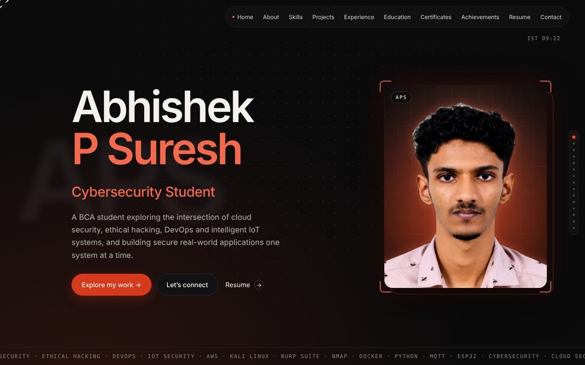
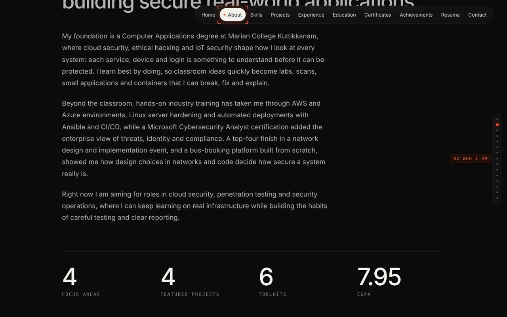
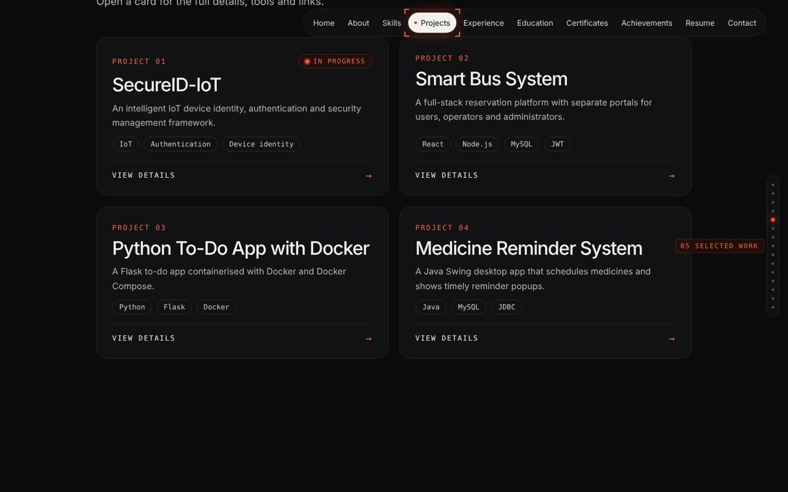
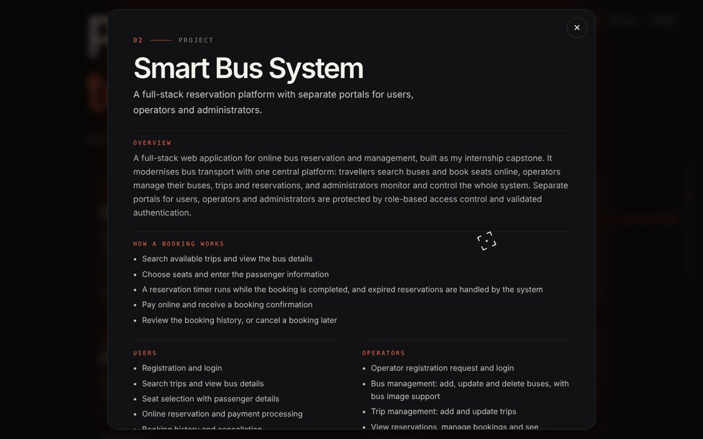
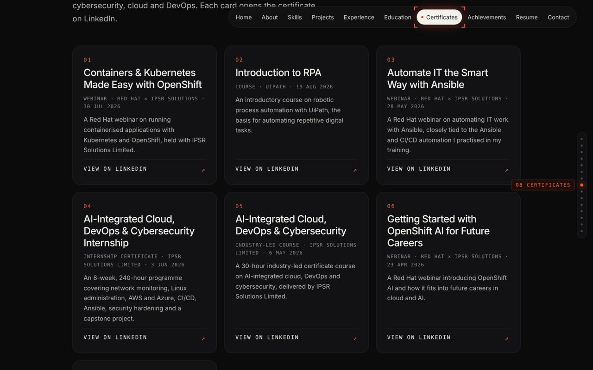
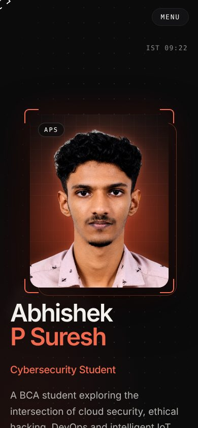
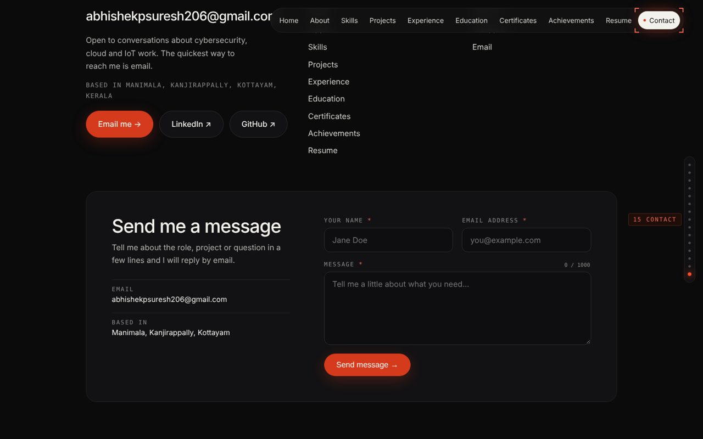

<div align="center">

# Abhishek P Suresh — Portfolio

**Cybersecurity student · Cloud security · Ethical hacking · DevOps · IoT security**

A dark, editorial single-page portfolio with a custom cursor, scroll-driven sections and interactive project cards. Plain HTML, CSS and JavaScript, with no build step.


<!-- Add your live link after the first Vercel deploy, for example: **[Live site](https://YOUR-PROJECT.vercel.app)** -->

</div>



## About

This repository holds my personal portfolio. It introduces who I am, what I work on (cybersecurity, cloud security, IoT security and DevOps), the projects I have built, my certificates and achievements, and how to reach me. The whole site is one `index.html` file, so it loads fast and deploys anywhere that can serve static files.

## Features

- **Editorial dark design** with large type, an orange accent and a dotted grid hero.
- **Launch animation**: shutters split open, the name decrypts with a glitch, the portrait prints in under a scan beam and the navigation drops in. It is skipped for visitors who prefer reduced motion.
- **Floating navigation** with active-section highlighting, a side dot navigator and a menu button on small screens.
- **Custom cursor** that spins while idle and stretches into corner brackets around links, buttons and cards.
- **Scroll-driven "What I do"** section that pins to the screen and steps through four focus areas, each with a technical detail popup.
- **Project cards** that open a large details card with a 360° spin, with the overview, features, tools and GitHub links.
- **Hero portrait** on a studio-style background, inside a targeting-reticle frame with a scanning line.
- **Living canvas** card in the About section that reacts to the pointer.
- **Contact form** with name, email and message, validation, a spam trap and delivery to your inbox through Web3Forms (see below).
- **Certificates and achievements** cards with titles, issuers, dates and links to LinkedIn.
- **Resume** section with the full resume on the page and a one-click PDF download.
- **Responsive and accessible**: keyboard-friendly cards and dialogs, visible focus styles, reduced-motion support and semantic landmarks.
- **Fast by default**: no framework, no build, and animations that pause when they scroll out of view.

## Preview

| About | Projects |
| --- | --- |
|  |  |

| Project details | Certificates |
| --- | --- |
|  |  |

<details>
<summary>Mobile view</summary>



</details>



## Sections

| # | Section | What it shows |
| --- | --- | --- |
| 01 | Who I am | Introduction, background, stats and the living canvas card |
| 02 | What I do | Cybersecurity, cloud security, IoT security, DevOps |
| 03 | Technical arsenal | Tools and technologies grouped by area |
| 04 | Projects | SecureID-IoT, Smart Bus System, Python To-Do App with Docker, Medicine Reminder System |
| 05 | Experience | Internship, achievements and training timeline |
| 06 | Education | BCA, Higher Secondary and SSLC |
| 07 | Certificates | Eight certificates, with LinkedIn links where available |
| 08 | Achievements | Event rank and an educational programme |
| 09–12 | How I work, Current focus, Why work with me, Let's talk | Working approach and collaboration |
| 13 | Resume | Full resume and PDF download |
| 14 | Contact | Message form, email, LinkedIn, GitHub and location |

## Tech stack

- **HTML5, CSS3 and vanilla JavaScript**, all in `index.html`
- **Canvas 2D** for the living canvas animation
- **Google Fonts**: Inter Tight and JetBrains Mono, with system fallbacks
- **GitHub Actions** for checks, **Vercel** for hosting

## Project structure

```text
portfolio/
├── index.html                  # The whole site: markup, styles and scripts
├── resume.pdf                  # File behind the Download resume button
├── assets/
│   ├── abhishek.webp           # Studio-style portrait used in the hero
│   └── screenshots/            # Images used in this README
├── scripts/
│   └── check-links.js          # Fails the build on broken in-page links
├── .github/workflows/
│   └── ci-cd.yml               # Lint, link check and optional Vercel deploy
├── .htmlhintrc                 # HTML lint rules
├── vercel.json                 # Vercel settings and security headers
└── README.md
```

## Run it locally

There is nothing to install or build. From the project folder, start any static server:

```bash
python3 -m http.server 8000
```

Then open <http://localhost:8000>. You can also open `index.html` directly in a browser.

## Deploy

### 1. Push to GitHub

Create an empty repository on GitHub (no README, no .gitignore), then run:

```bash
git init
git add .
git commit -m "Initial portfolio"
git branch -M main
git remote add origin https://github.com/abhishekpsuresh/portfolio.git
git push -u origin main
```

### 2. Host on Vercel

1. Sign in at [vercel.com](https://vercel.com) with your GitHub account.
2. Choose **Add New → Project** and import the repository.
3. Set the framework preset to **Other** and leave the build and output settings empty.
4. Click **Deploy**.

After this, every push to `main` goes live and every pull request gets its own preview URL.

### Alternative: deploy from GitHub Actions

Use this only if you do not use Vercel's own GitHub integration, otherwise you will get two deployments.

1. Run `npx vercel link` once locally and note `orgId` and `projectId` in `.vercel/project.json`.
2. Create a token at [vercel.com/account/tokens](https://vercel.com/account/tokens).
3. In GitHub, open **Settings → Secrets and variables → Actions** and add `VERCEL_TOKEN`, `VERCEL_ORG_ID` and `VERCEL_PROJECT_ID`.

## Contact form

The form collects a name, email address and message. It validates every field, limits the message to 1000 characters and includes a hidden spam trap field. Messages are delivered by [Web3Forms](https://web3forms.com), which forwards each one to your inbox. There is no server and no code to write.

### Delivery setup (already done for this site)

1. Go to [web3forms.com](https://web3forms.com), enter `abhishekpsuresh206@gmail.com` and get your free **Access Key** by email.
2. In `index.html`, find this block just above the main script near the end of the file and paste the key between the quotes of `FORM_ACCESS_KEY`:
   ```html
   <script>
     window.FORM_ENDPOINT = "https://api.web3forms.com/submit";
     window.FORM_ACCESS_KEY = "";
   </script>
   ```
3. Commit and push:
   ```bash
   git add .
   git commit -m "Enable contact form delivery"
   git push
   ```

Web3Forms designs the access key to sit in public page code, and it only delivers to the email address you registered.

### How it behaves

- **Key set and the hosted site:** the message is sent to Web3Forms and arrives in your inbox. The visitor sees a thank-you message, and your inbox shows who wrote to you, with the visitor's address as the reply address.
- **No key yet, or the request fails:** the form opens the visitor's email app with the message ready to send, so a visitor can always reach you.
- **Other services:** to use Formspree or a similar service, set `FORM_ENDPOINT` to its URL and leave `FORM_ACCESS_KEY` empty.

## CI/CD pipeline

`.github/workflows/ci-cd.yml` runs on every push to `main` and on every pull request.

| Job | When | What it does |
| --- | --- | --- |
| Lint and checks | Always | Lints `index.html` with HTMLHint, checks that every in-page `#link` points to a real section, and fails if a phone-like number is found in the page |
| Preview deploy | Pull requests | Builds and deploys a preview with the Vercel CLI, only if the Vercel secrets exist |
| Production deploy | Push to `main` | Builds and deploys to production with the Vercel CLI, only if the Vercel secrets exist |

## Customise

| To change | Where |
| --- | --- |
| Colours | CSS variables at the top of `index.html` (`--bg`, `--fg`, `--ac`) |
| Projects and their popups | The `PJ` array in the script |
| Certificates and achievements | The `CERTS` and `ACH` arrays in the script |
| Services and technical details | The `SV` and `TD` arrays in the script |
| Skill groups | The `K` array in the script |
| Portrait | Replace `assets/abhishek.webp` with a 4:5 portrait image of the same name |
| Resume | Replace `resume.pdf`, keeping the file name |

## Privacy note

`resume.pdf` and everything else in a public repository can be read by anyone. The page itself shows no phone number, and the CI check guards `index.html` against one being added by mistake. If your resume lists a phone number you want to keep private, replace `resume.pdf` with a version that leaves it out.

## Credits

The visual language was inspired by [aaftab.is-a.dev](https://aaftab.is-a.dev/). The code, copy, photo and assets in this repository are my own work.

## License

© 2026 Abhishek P Suresh. All rights reserved. The text, photo, certificates and resume are personal content and are not licensed for reuse.

## Contact

- Email: [abhishekpsuresh206@gmail.com](mailto:abhishekpsuresh206@gmail.com)
- LinkedIn: [linkedin.com/in/abhishekpsuresh0210](https://www.linkedin.com/in/abhishekpsuresh0210/)
- GitHub: [github.com/abhishekpsuresh](https://github.com/abhishekpsuresh)
- Location: Manimala, Kanjirappally, Kottayam, Kerala
